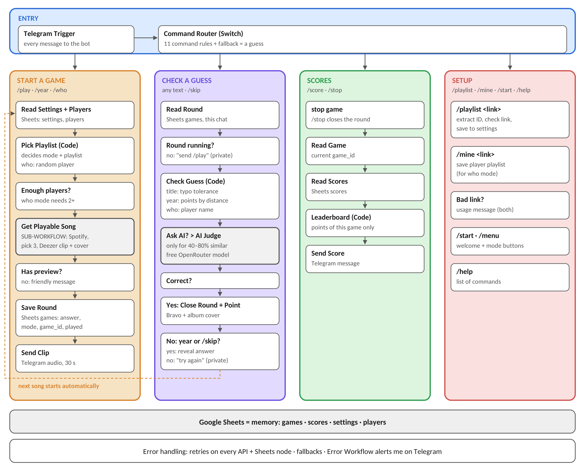

# BlindBeat 

A Telegram blind-test bot built with n8n. Send it a Spotify playlist: it plays 30-second clips (via Deezer), checks guesses and keeps score.

**Need:** blind tests with friends are messy. One person plays songs from their phone, everyone shouts, and the score lives on paper.

**Level 3.** Full proposal: [docs/proposal.pdf](docs/proposal.pdf)



## What's in the repo

| Path | Content |
|---|---|
| `docker-compose.yml` | n8n + Postgres, pinned versions, named volumes, healthcheck |
| `.env.example` | Environment variables to copy into `.env` |
| `workflows/blind-test-bot.json` | Main workflow (Telegram trigger, Switch, game logic) |
| `workflows/get-playable-song.json` | Sub-workflow: Spotify tracks → Deezer 30 s preview |
| `workflows/error-handler.json` | Error workflow: Telegram alert with workflow name and execution URL |
| `docs/` | Architecture diagram and proposal |

## Setup

```bash
git clone https://github.com/<Lara-Normand-Pro>/blindbeat.git
cd blindbeat
cp .env.example .env     # fill in your own values
docker compose up -d
```

Open http://localhost:5678, then:

1. Import the 3 files from `workflows/`.
2. Add credentials: Telegram, Spotify, Google Sheets, OpenRouter.
3. Publish **Get Playable Song** and **Error Handler** first, then **Blind Test Bot**.

**Environment variables:** `POSTGRES_USER`, `POSTGRES_PASSWORD` (database login), `N8N_ENCRYPTION_KEY` (encrypts credentials), `WEBHOOK_URL` (public HTTPS URL so Telegram can reach the bot).

## How to test

Send `/start` to the bot → tap **Guess the title** → send a guess → `/score` → `/stop`.
Other commands: `/year`, `/who`, `/mine <link>`, `/playlist <link>`, `/skip`, `/help`.

Data survives a restart: `docker compose down` then `docker compose up -d`.

---
Lara Normand · No-code software development · ESSEC
